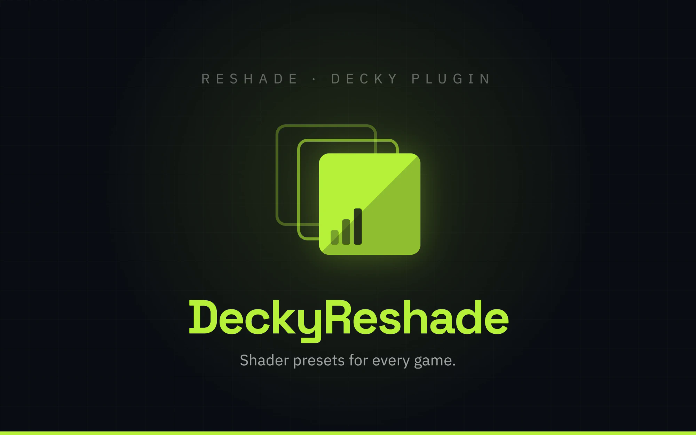
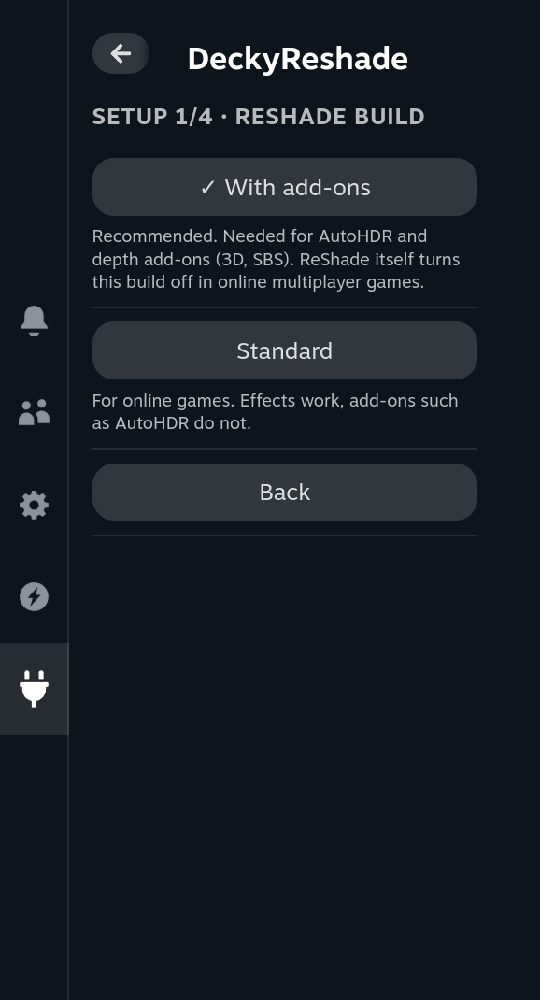
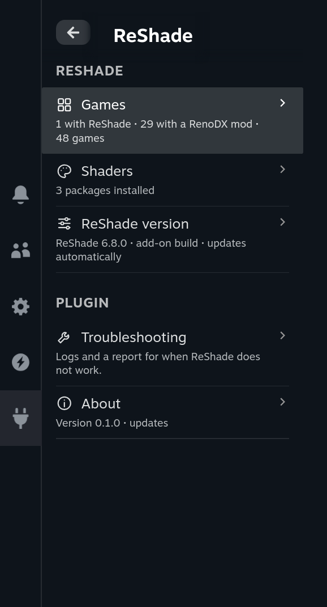
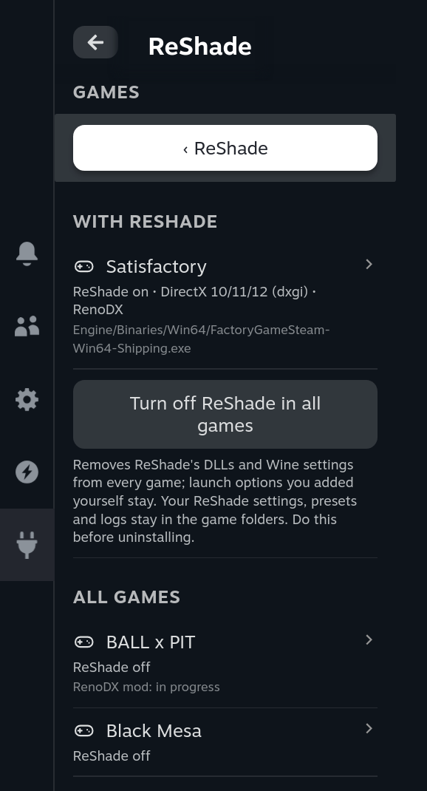
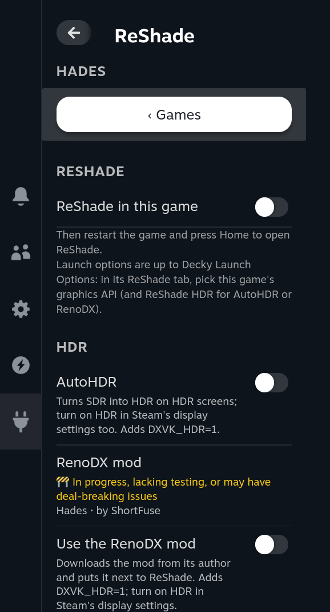
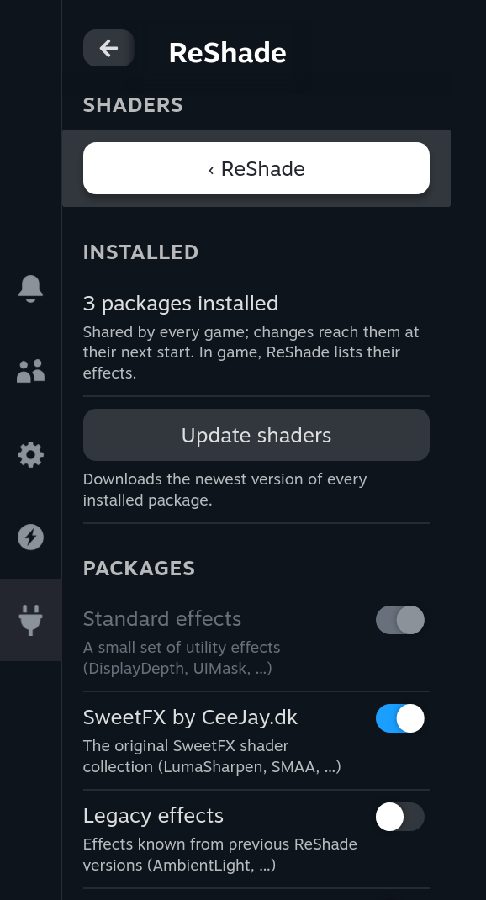
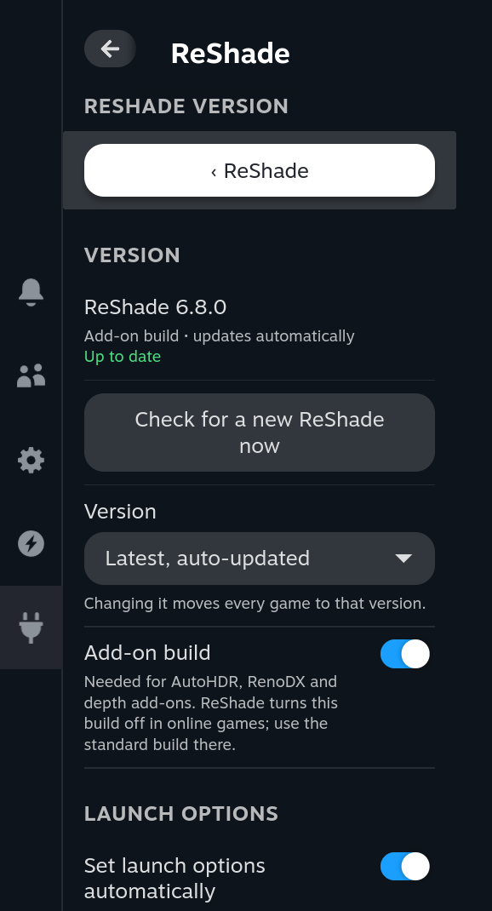
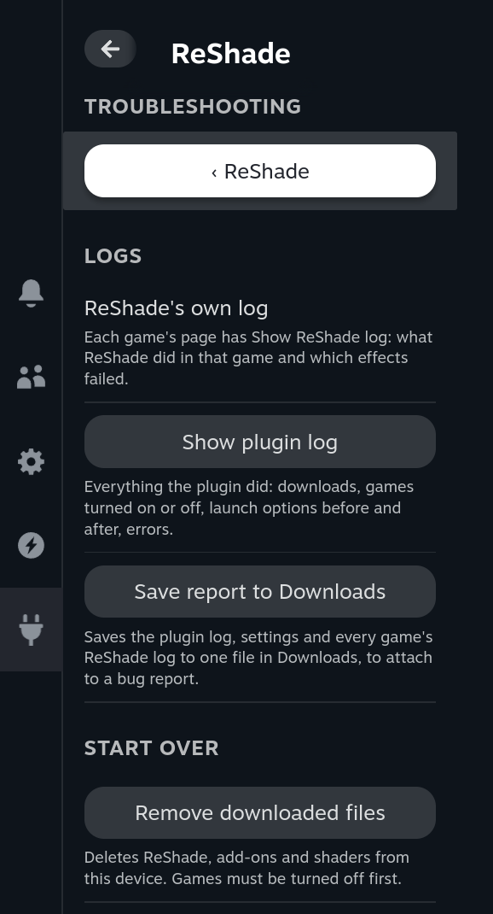

<div align="center">



[](https://github.com/Rayekkk/DeckyReshade/releases/latest)
[](https://github.com/Rayekkk/DeckyReshade/releases)
[](#requirements)
[](https://decky.xyz)
[](#license)

**ReShade for your Steam and non-Steam games, set up and kept up to date from Gaming Mode.**
Turn ReShade, AutoHDR or a RenoDX HDR mod on per game from the Quick Access Menu. ReShade, shaders and mods come straight from their authors, launch options are handled for you, and every change can be undone.

[Features](#features) · [Requirements](#requirements) · [Installation](#installation) · [Quick start](#quick-start) · [Using the plugin](#using-the-plugin) · [Troubleshooting](#troubleshooting) · [How it works](#how-it-works) · [AI disclaimer](#ai-disclaimer)

</div>

---

## Features

ReShade itself works under Proton, but setting it up by hand means finding the right executable, the right DLL
name and bitness, a shader compiler Proton lacks, shader folders and launch options, and doing it again for every
update. DeckyReshade does all of that from the Quick Access Menu and keeps track of it, so it can also be undone.

| Feature | What you get |
|---|---|
| **Guided setup** | On first open it asks which ReShade build (add-ons, recommended) and version you want and whether to get AutoHDR, then downloads everything (about 15 MB) |
| **Per game** | The game you are playing is at the top. The executable, its bitness and its graphics API are read from the game files; you can change both |
| **Non-Steam games** | Windows games and emulators added to Steam work like Steam games |
| **AutoHDR** | HDR for SDR games on HDR screens (Steam Deck OLED, Legion Go 2 and other OLED handhelds), per game |
| **RenoDX** | Every game in your library that has a [RenoDX](https://github.com/clshortfuse/renodx) HDR mod shows its status (✅ working or 🚧 in progress); one switch downloads and installs it |
| **ReShade updates** | The newest ReShade DeckyReshade has checksums for, updated automatically in every game, or a fixed version (6.3.3 to 6.8.0); a newer ReShade on reshade.me is announced and comes with a plugin update |
| **Shader packages** | The same list ReShade's own installer offers, shared by all games, with updates |
| **Safe launch options** | `WINEDLLOVERRIDES` entries are merged with what is already there and restored exactly when you turn ReShade off; [Decky Launch Options](https://github.com/Rayekkk/DeckyLaunchOptions) gets its own ReShade tab |
| **Never fails silently** | Each game shows when ReShade last started and its errors; if it did not start twice in a row, you are told what to change |
| **Logs and report** | ReShade's log per game, the plugin's log, and a one-file report for bug reports |
| **Clean rollback** | Only files the plugin wrote are removed (checked by SHA-256); your ReShade settings and presets stay (only an AutoHDR starter preset you never changed goes with AutoHDR) |
| **Updates** | **About → Check for updates** downloads a newer release from GitHub to your Downloads folder and checks it |

## Requirements

| Requirement | Details |
|---|---|
| System | SteamOS in Gaming Mode with [Decky Loader](https://decky.xyz) |
| Games | Windows games run through Proton that use DirectX 8, 9, 10, 11, 12 or OpenGL |
| AutoHDR | The add-on build, a DirectX 10/11/12 game, an HDR screen and HDR turned on in Steam's display settings |
| RenoDX | The add-on build and a mod in the RenoDX list with a direct download for the game's bitness |
| Network | For setup, ReShade updates, shader packages and RenoDX mods |

Native Vulkan games (and the Vulkan modes of games such as Hades or Red Dead Redemption 2) are not supported:
ReShade hooks Vulkan as a Windows Vulkan layer, which Proton does not load. DirectX games are fine even though
Proton runs them on Vulkan, because ReShade sits in front of DirectX. Games that Steam runs as native Linux
versions have no Windows executable; force a Proton version in the game's compatibility settings first.

ReShade's **add-on build** switches its add-ons off in online multiplayer games, and putting DLLs in a game's
folder can get you kicked or banned where anti-cheat is used: games with anti-cheat files (Easy Anti-Cheat,
BattlEye, XIGNCODE, nProtect GameGuard, PunkBuster, EQU8) get a red warning on their page.

## Installation

1. Install [Decky Loader](https://decky.xyz) if you do not already have it.
2. Download `DeckyReshade-<version>.zip` from [Releases](https://github.com/Rayekkk/DeckyReshade/releases).
3. In Gaming Mode, open **Quick Access Menu → Decky → Settings**, turn on **Developer mode** under
   **General**, then open **Developer**.
4. Choose **Install Plugin from ZIP**, select the archive, then open **ReShade** in Decky.

### Updating

Open **About → Check for updates**. When a newer release is out, **Download** saves its ZIP to your Downloads
folder after checking it against the SHA-256 GitHub publishes; install it the same way as above. Your games stay
set up.

### Uninstalling

Open **Games** and press **Turn off ReShade in all games** first: Decky handles a plugin update as uninstall plus
install, so the plugin never removes anything from games on its own. Then **Troubleshooting → Remove downloaded
files** deletes ReShade, add-ons and shaders. To clean a game by hand, delete the ReShade DLL (`dxgi.dll`,
`d3d9.dll`, … next to its executable), `d3dcompiler_47.dll` if the game did not ship one, `AutoHDR.addon*` and
`renodx-*.addon*`, and remove `WINEDLLOVERRIDES` (and `DXVK_HDR=1`) from its launch options.

## Quick start

<a href="docs/screenshots/setup.png"></a>

1. Open **ReShade** in Decky and follow the setup: the build (add-ons recommended), the version (latest), AutoHDR,
   then **Download and set up**.
2. Start a game and open the Quick Access Menu: **This game** is at the top. Open it and turn on **ReShade in this
   game**.
3. Restart the game and press **Home** to open ReShade. No keyboard? Map Home to a back button in the game's
   controller layout.
4. Quit the game. Its page shows when ReShade last started and whether anything failed.

<a href="docs/screenshots/overview.png"></a>

## Using the plugin

The main page lists what you can do; each row opens its own page and **‹** takes you back.

### Games

<a href="docs/screenshots/games.png"></a>
<a href="docs/screenshots/game.png"></a>

**Games** lists your library: the games with ReShade first, then all others, the one you are playing on top, each
with its RenoDX status. A game's page has three parts:

| Part | What is in it |
|---|---|
| **ReShade** | The switch, and when ReShade last started in the game with its errors |
| **HDR** | **AutoHDR**; the game's **RenoDX mod** with its status, maintainer and notes, **Use the RenoDX mod**, **Update RenoDX mod**, and **Another RenoDX mod** when the match is wrong or missing |
| **Advanced** | **Executable** (the one running right now is marked), **Graphics API** (Auto, or DirectX 10/11/12, Direct3D 8/9, 10, 11, 12, OpenGL, or dinput8 as a last resort) and **Show ReShade log** |

Changing anything while ReShade is on sets the game up again with the new choice.

### HDR: AutoHDR and RenoDX

- **AutoHDR** adds the [AutoHDR add-on](https://github.com/EndlesslyFlowering/AutoHDR-ReShade) and turns on
  [Pumbo's AdvancedAutoHDR](https://github.com/Filoppi/PumboAutoHDR) in a first preset (only when the game has no
  preset yet). Fine-tune it in ReShade's menu.
- **RenoDX** mods rebuild a game's tone mapping for real HDR. The list comes from the
  [RenoDX wiki](https://github.com/clshortfuse/renodx/wiki/Mods) and is refreshed once a day. A mod is installed
  only from the GitHub release of a RenoDX author DeckyReshade knows, and only when it matches the checksum GitHub
  publishes for it; mods only on Nexus Mods or Discord, or from another author, show their link to install by hand.
  Engine-wide mods (Unreal, Unity, Source) need per-game tweaks and are not offered.
- Both add `DXVK_HDR=1` to the launch options. Use one or the other: together they tone-map twice.

### Shaders

<a href="docs/screenshots/shaders.png"></a>

The standard effects and SweetFX come with setup. Any package from ReShade's own list can be added or removed;
**Update shaders** fetches their newest versions. All games share them.

### ReShade version

<a href="docs/screenshots/reshade-version.png"></a>

- **Version**: *Latest* is the newest version DeckyReshade has checksums for, and every game gets new versions by
  itself; reshade.me is checked once a day, and a newer ReShade there is announced until a DeckyReshade update brings
  it. A fixed version stays until you change it (6.5.1 is the one to try when a DXVK HDR game breaks ReShade's menu).
- **Add-on build**: needed for AutoHDR, RenoDX and depth add-ons.
- **Set launch options automatically** (on by default) puts `WINEDLLOVERRIDES="d3dcompiler_47=n,b;<api>=n,b"` in
  the game's launch options, next to anything already there; off leaves them to you.
- **RenoDX mod list**: refresh it by hand.

### Launch options and Decky Launch Options

A game can have only one `WINEDLLOVERRIDES`: when it already has one (your own overrides, or another tool such as
[FSR4 Injector](https://github.com/Rayekkk/FSR4Injector)), the plugin adds its entries to it and takes out only
those when you turn ReShade off. Overrides set outside Steam's launch options are not visible to the plugin.

With [Decky Launch Options](https://github.com/Rayekkk/DeckyLaunchOptions) installed, it decides the launch
options: DeckyReshade puts the files in the game and offers DLO a **ReShade** tab (Off or a graphics API per game,
plus ReShade HDR for AutoHDR and RenoDX) to switch there. Decky Launch Options merges it with your other
`WINEDLLOVERRIDES`.

## Troubleshooting

<a href="docs/screenshots/troubleshooting.png"></a>

| What you see | What to do |
|---|---|
| "ReShade has not started in this game yet" after playing | Pick the **Executable** marked *running now* while the game runs, or another **Graphics API**; dinput8 works with most games |
| "ReShade did not start in … twice in a row" | The same, and check the game's launch options (or its choice in Decky Launch Options) still set `WINEDLLOVERRIDES` |
| Errors under "Last start" | **Show ReShade log** names the failing effect; **Update shaders**, or turn that effect off in ReShade |
| "No Windows executable found" | Steam runs the native Linux version; force Proton in the game's compatibility settings |
| "…already exists in the game folder and is not ours" | Another ReShade or a mod uses the same file name; the plugin leaves it alone |
| "Steam did not return the launch options" | Nothing was changed; try again |
| "…quote text with spaces in it…" | Turn off **Set launch options automatically** and add the entries yourself |
| "The game's folder is not available" | Its SD card is out; put it back and try again |
| "Decky Launch Options still adds ReShade's WINEDLLOVERRIDES…" | Set ReShade to Off for the game in Decky Launch Options |
| Washed-out or too bright HDR | Turn on HDR in Steam's display settings, and use AutoHDR or RenoDX, not both |
| "Could not check for a new ReShade" | reshade.me is unreachable; games keep their ReShade, it checks again tomorrow |

**Reporting a problem:** **Troubleshooting → Save report to Downloads** saves the plugin log, settings and every
game's ReShade log to one file; attach it with the game and what the page says.
[CHANGELOG.md](CHANGELOG.md) lists the changes in each version.

## How it works

<details>
<summary><b>Downloads, game files, launch options and checks</b></summary>

ReShade is not on GitHub. Its homepage links the current installer, and that link is the version check. The
installer is a ZIP archive behind a Windows program, so the plugin reads `ReShade32.dll` and `ReShade64.dll`
straight out of it and checks their PE headers. reshade.me publishes no checksums, so only versions whose installers'
SHA-256 the plugin carries are installed; a failed check changes nothing already set up. RenoDX snapshot builds
change daily, so each one is checked against the SHA-256 GitHub reports for its author's release asset, and only the
accounts of known RenoDX authors are used: the wiki that lists the mods can be edited by anyone. Proton's own
`d3dcompiler_47` cannot compile ReShade's effects, so Microsoft's comes from Mozilla's fxc2 repository at a fixed
commit, checked by SHA-256, and so does the AutoHDR add-on from its release.

The executable is the one the game is running, else the best guess (Unreal's `-Shipping` build, the game's name,
size; launchers, crash handlers and Vulkan builds rank lower; a non-Steam shortcut names its own). Its PE header
gives the bitness. The graphics API comes from what it imports: only DirectX 10-12 decides alone, because engines
link OpenGL as a fallback (Unity) and big DirectX 12 games import Direct3D 9 for side jobs, so the DLL names the
files mention are read too, and the engine DLLs beside an exe that says nothing (Hades).

Next to the executable go ReShade under the API's name, `d3dcompiler_47.dll` for the same bitness (unless the
game ships its own), the add-ons in use and a `ReShade.ini` pointing at the shared shader folders. Files are only
ever added: a file of the same name that is not ours stops the setup, every file written is recorded with its
SHA-256 and removed only while it still matches. `ReShade.ini`, your presets and `ReShade.log` stay as your
settings; the first AutoHDR preset the plugin writes goes with AutoHDR while you have not changed it.
A ReShade update replaces only the files that still match what was installed.

After each session the plugin checks that ReShade wrote its log during it; a game where it did not twice in a
row gets a notification. Nothing is installed system-wide and Proton is not modified.

</details>

## Development

<details>
<summary><b>Build, test and package from source</b></summary>

Requires Node.js 24 and Python 3.14 (the version Decky Loader 3.3.1 and SteamOS use).

```bash
npm ci --ignore-scripts --no-audit --no-fund
npm run check          # everything below in one go
npm run typecheck      # frontend types
npm run test:backend   # Python backend tests
npm run test:frontend  # panel tests (navigation, game page switches)
npm run build          # compile the frontend and check the bundle
npm run package        # create artifacts/DeckyReshade-<version>.zip and its .sha256
```

Install the result through Decky's **Install Plugin from ZIP**. GitHub Actions runs the backend tests on Linux and
Windows and checks the frontend and the built ZIP, which must not contain any DLL, EXE or add-on. Steam, Decky and
the download servers are mocked in the tests; game sessions still need testing on a handheld.

</details>

---

## Credits

- **crosire** and [ReShade](https://reshade.me) - the post-processing injector
- **EndlesslyFlowering** - the [AutoHDR add-on](https://github.com/EndlesslyFlowering/AutoHDR-ReShade)
- **Pumbo (Filoppi)** - [AdvancedAutoHDR](https://github.com/Filoppi/PumboAutoHDR)
- **clshortfuse** and the [RenoDX](https://github.com/clshortfuse/renodx) mod authors
- [Mozilla fxc2](https://github.com/mozilla/fxc2) - Microsoft's shader compiler for Proton
- The shader authors in ReShade's package list
- [LetMeReShade](https://github.com/Cliffback/LetMeReShade) - the Decky plugin that showed ReShade belongs in Gaming Mode
- [Decky Loader](https://github.com/SteamDeckHomebrew/decky-loader) - the plugin platform

Component licenses are recorded in [NOTICE](NOTICE).

---

## License

Plugin code: BSD 3-Clause - see [LICENSE](LICENSE). ReShade, the add-ons, RenoDX mods, shaders and Microsoft's
compiler are not included; each is downloaded on your device from its authors and stays under its own licence.
Not affiliated with ReShade, RenoDX or Valve.

---

## AI disclaimer

This project was built with substantial help from AI coding assistants. Most of the code,
tests and documentation were written by AI agents (Anthropic's Claude Code) working under my
direction: I defined what each feature should do, made the design and safety decisions,
reviewed the results and chose what was released.

The AI was used to:

- write the Python backend and the Decky panel;
- build the automated test suites (about 200 tests run on Linux and Windows for every change);
- audit the code for bugs, security issues and wasted work, with every finding checked by
  independent review passes and, where possible, reproduced before it was fixed;
- research how ReShade, its installer, AutoHDR, RenoDX and Decky Launch Options work, and write
  this documentation.

Nothing here is untested AI output. I tested the plugin on my Legion Go 2 in Gaming Mode:
setup, ReShade in DirectX 11 games with the shaders compiling and the AutoHDR add-on loading,
RenoDX mod downloads, switching ReShade versions, launch options with and without Decky Launch
Options, logs and the report, and executable and API detection across a 46-game library.
Features were held back until they behaved correctly on the real device, and a checked SHA-256
for every DLL and add-on placed in a game folder, and an exact rollback of each game's files and
launch options, were kept as hard requirements. HDR output and Direct3D 9 games still need more
testing.

Even so, this plugin changes files in your game folders. It is provided as is, without warranty
(see [License](#license)); use it at your own risk.
